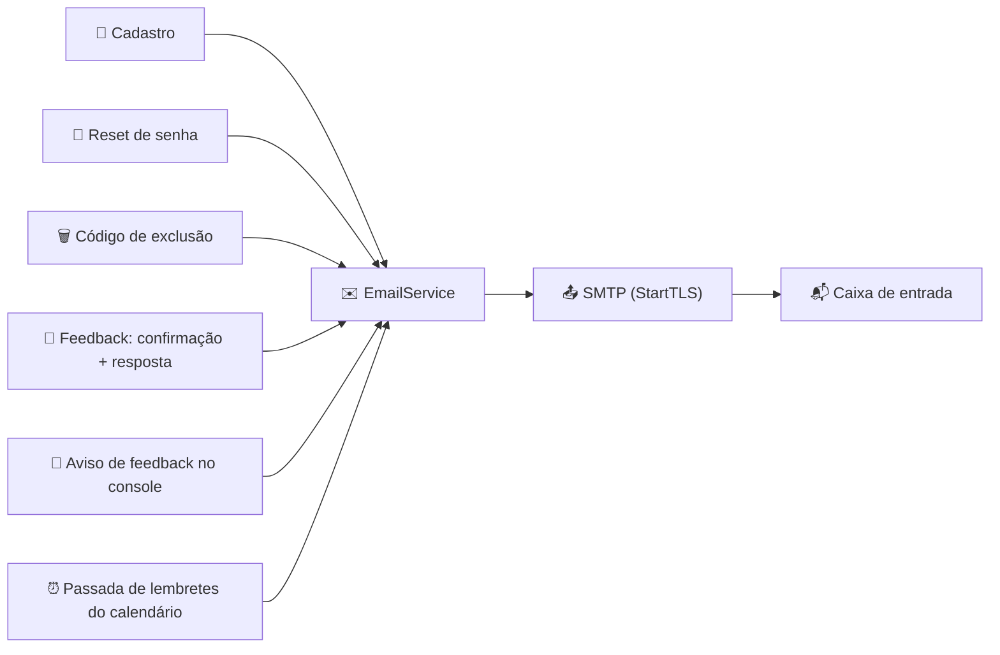

Este documento cobre o subsistema de e-mail: quais mensagens existem, como cada uma é mantida segura em relação à transação, como falhas são tratadas por fluxo e como os templates são construídos e localizados.

## O que é enviado

O sistema envia oito e-mails, todos de uma única classe de serviço no pacote de notificação. Seis são transacionais (alguém pediu cada um deles, fazendo alguma coisa), e é por isso que nenhum desses consulta preferência nenhuma. O sétimo é o nudge de engajamento, o primeiro e-mail daqui que ninguém pediu, e por isso ele consulta uma chave, gasta orçamento e sobe desligado. O oitavo é o lembrete do calendário, que fica no meio do caminho. O usuário pediu por ele ao criar um lembrete, então ele sobe ligado. Mesmo assim chega numa agenda e não em resposta a um clique, então tem chave própria e orçamento próprio. Ver [O e-mail de engajamento é opt-out](#o-e-mail-de-engajamento-é-opt-out), [Os nudges, e quando eles não saem](#os-nudges-e-quando-eles-não-saem) e [Lembretes do calendário](#lembretes-do-calendário).

| # | E-mail | Gatilho | Contém |
|---|--------|---------|--------|
| 1 | Verificação de cadastro | Conta nova criada, ou um reenvio pedido | Botão com link para a página de verificação, aviso de expiração em 24 horas |
| 2 | Redefinição de senha | Pedido de esqueci-a-senha | Botão com link para a página de reset, TTL em minutos |
| 3 | Código de exclusão de conta | Exclusão solicitada | Seis dígitos, deliberadamente sem link e sem botão: uma exclusão não pode estar a um clique de uma caixa de entrada |
| 4 | Confirmação de feedback | Usuário envia feedback | Eco da categoria e do texto enviado |
| 5 | Resposta de feedback | Admin responde | A resposta mais o original citado de volta |
| 6 | Aviso de feedback no console | Usuário envia feedback | Um link para o console de admin, e nada além disso |
| 7 | Nudge de engajamento | Uma passada agendada, num horário civil de onde quem lê está | Uma coisa em jogo e o número por trás dela, um link para o app e uma linha de cancelamento. O único que leva um link de cancelamento |
| 8 | Lembrete do calendário | Uma passada a cada cinco minutos encontra um lembrete que ninguém respondeu até uma hora depois do seu instante | O título da tarefa como assunto, a data, o horário e a nota, um botão para o calendário naquele dia, e um rodapé que aponta para a configuração de Lembretes que desliga estes e-mails |

Igualmente deliberado é o que nunca é enviado: uma mudança de status de feedback não avisa ninguém (não existe listener, então nenhum endpoint futuro pode enviar e-mail por acidente), cadastros via Google não recebem nada (o Google já verificou o endereço) e nada anuncia a conclusão do reset de senha nem a exclusão efetiva da conta.

O aviso é o único e-mail endereçado a quem opera o produto, e não a um usuário, e o vazio dele é o projeto. Leva um link e nenhuma categoria, nenhum remetente e nada do texto enviado: feedback pode ser pessoal, e copiar isso para dentro de um provedor de e-mail só para poupar um clique é um mau negócio. Quem recebe é quem tem ROLE_ADMIN no momento do envio, menos quem escreveu, então um admin que manda feedback recebe o recibo de sempre e nenhuma segunda mensagem sobre si mesmo. Um envio produz, portanto, um recibo mais uma mensagem por admin, cada uma endereçada individualmente — um To: compartilhado mostraria a cada admin o endereço dos outros.

## Três jeitos de desacoplar da transação

Todo e-mail precisa esperar o commit da sua transação; um link de reset apontando para um token que sofreu rollback seria pior que nenhum e-mail. O código chega a esse objetivo de três formas diferentes, e as diferenças importam:

| Fluxo | Mecanismo | Thread |
|-------|-----------|--------|
| Confirmação, resposta e aviso de feedback | Listener @Async em evento transacional AFTER_COMMIT | Segundo plano |
| Reset de senha, código de exclusão | Sincronização afterCommit registrada à mão | A thread da requisição: a resposta HTTP espera o SMTP |
| Verificação de cadastro | Listener @Async comum, sem fase transacional | Segundo plano |
| Reenvio de verificação | Sincronização afterCommit registrada à mão | A thread da requisição: a resposta HTTP espera o SMTP |

O caminho do cadastro merece etiqueta de aviso própria: ele só é correto porque o `registerUser` não carrega `@Transactional`, então o save já commitou quando o evento é publicado. Adicionar `@Transactional` àquele método reintroduziria em silêncio a corrida de enviar-antes-do-commit que os outros fluxos evitam.

Nenhum executor é configurado; o `@Async` usa o padrão de virtual threads. Sem limite, sem fila, sem retry em lugar nenhum.

## Quando o SMTP falha

Cada fluxo responde à falha de um jeito, e as diferenças são o design:

- **Reset de senha**: o erro é registrado e a linha do token é apagada, para o cooldown de 5 minutos não deixar um usuário preso esperando um link que nunca saiu do prédio.
- **Código de exclusão**: mesma ideia, borda mais afiada. A linha do código é descartada por um helper REQUIRES_NEW, porque o descarte roda depois do commit, onde uma chamada comum de repositório entraria em uma transação morta. Ninguém recebeu o código, então ninguém deveria cumprir o cooldown.
- **E-mails de feedback**: registrados e engolidos. O envio ou a resposta sobrevivem; o recibo é melhor esforço. O recibo e o aviso ficam em blocos try separados de propósito, e o aviso captura de novo a cada destinatário, então uma caixa morta custa uma mensagem em vez de esconder um envio do console.
- **Verificação de cadastro**: nada captura a falha. A exceção morre no log padrão do handler assíncrono, e a linha do usuário e seu token ficam. Isso era irrecuperável — o login recusa contas não verificadas com EMAIL_NOT_VERIFIED, a coluna de e-mail é única então cadastrar de novo também é recusado, e depois de 24 horas o token expirava sem nada capaz de emitir outro. O único conserto era um UPDATE na mão.
- **Reenvio de verificação**: a cura da linha acima, e responde à falha como o código de exclusão. O envio roda em `afterCommit`, e uma exceção limpa o `verificationTokenSentAt` da conta por um helper REQUIRES_NEW, então ninguém cumpre cooldown por um e-mail que nunca saiu. Vale dizer sem rodeio: isso só pega o SMTP recusando a entrega. Uma mensagem que o provedor aceita e depois devolve, ou que cai no spam, não lança exceção em lugar nenhum — e é por isso que uma segunda tentativa que o usuário pode pedir importa mais do que qualquer quantidade de log de falha.

- **Lembrete do calendário**: registrado em ERROR com os ids da tarefa e do usuário, nunca o título, que são as palavras do próprio usuário, e a passada segue para o próximo lembrete. A tarefa fica sem marca, então a passada cinco minutos depois tenta de novo enquanto o lembrete tiver menos de um dia.

Tirando a passada de lembretes, não há retry, outbox nem rastreio de entrega em lugar nenhum. O que torna as falhas engolidas visíveis é o pipeline de logs: toda falha registra em ERROR, e linhas ERROR viram eventos no GlitchTip. O rastreador de erros é o sino do retry.

Duas notas operacionais, ambas resultado de correção e não de escolha de design. O indicador de saúde de mail do Spring está desligado: ele abria uma sessão SMTP autenticada de verdade a cada acesso ao `/actuator/health`, sem cache, o que entregava ao provedor de e-mail o veredito do monitor de uptime. Era redundante também, já que um envio que falha registra em ERROR e todo ERROR já é evento no GlitchTip. E os três timeouts do JavaMail estão fixados em 5s, porque o padrão é esperar para sempre: os envios de reset e de exclusão rodam de forma síncrona dentro do `afterCommit`, antes de a conexão JDBC voltar ao pool, então uma sessão SMTP sem resposta segurava tanto a request do usuário quanto uma das dez conexões do Hikari por tempo indeterminado.

## Configuração de SMTP

| Variável | Propósito |
|----------|-----------|
| MAIL_HOST / MAIL_PORT | Servidor SMTP, StartTLS habilitado, auth ligado |
| MAIL_USERNAME / MAIL_PASSWORD | Credenciais |
| MAIL_FROM | Endereço remetente, padrão MAIL_USERNAME |

E-mail não é opcional. Os quatro valores centrais vêm sem defaults, e a resolução do remetente falha na criação do bean quando as variáveis estão ausentes, então o app não sobe sem um ambiente de mail. Valores vazios sobem e falham a cada envio. O único modo sem SMTP sancionado é o perfil e2e, que contorna o e-mail em vez de desligá-lo: o cadastro auto-verifica e pula o evento, e o código de exclusão volta no corpo da resposta. As duas saídas de emergência são bloqueadas em produção pelo validador de boot.

## Templates e idiomas

Sem engine de template e sem arquivos de template: cada corpo é um text block Java inline, só HTML, formatado com String.formatted. Com dois idiomas por mensagem, isso dá quinze templates hardcoded dividindo o mesmo cabeçalho, o azul da marca e o rodapé com o ano (um número ímpar e não par porque o aviso do console é só em inglês). Os corpos do nudge e do lembrete do calendário são os únicos montados por partes, escapadas uma a uma antes de chegarem no frame: o nudge escolhe título e texto por gatilho e carrega números lidos da conta, e o lembrete carrega o título e a nota escritos pelo próprio usuário. Todos os outros templates escolhem idioma porque quem lê é um usuário; esse é endereçado a quem opera o produto, tem duas frases, e o conteúdo dele é uma URL.

A escolha de idioma é uma decisão de dois ramos por mensagem, feita em `UserLanguage.orDefault` para o e-mail e os prompts de IA concordarem: qualquer coisa começando com "pt" recebe português, todo o resto (incluindo nulo) recebe inglês. O cadastro agora salva o idioma que a tela estava mostrando, então o e-mail de verificação de uma conta nova chega nele. A parte interessante é de onde cada fluxo lê o idioma:

- A confirmação de feedback prefere o idioma capturado no contexto de UI do envio ao invés da preferência do perfil, porque o recibo chega na hora e uma conta criada antes de o cadastro levar idioma ainda pode estar sem nenhum até o próximo boot. Ler o perfil primeiro mandava um recibo em inglês para toda conta nova.
- A resposta de feedback prefere a preferência atual do perfil, porque uma resposta pode chegar dias depois, quando o contexto capturado já envelheceu.
- O lembrete do calendário também lê o idioma do perfil. Quem envia é uma passada agendada, sem requisição nem contexto de UI por perto.

Texto escrito por usuário ou admin passa por escape de HTML antes da interpolação, então um corpo de feedback não consegue injetar markup no próprio recibo.

## Cooldowns e rate limits

Duas camadas independentes controlam os endpoints que produzem e-mail:

| Fluxo | Cooldown no service | Balde de rate limit |
|-------|---------------------|---------------------|
| Reset de senha | 5 min entre pedidos por conta; cada token novo invalida o anterior | 5 / 15 min por IP (faixa auth) |
| Código de exclusão | 60 segundos, em segundos de propósito: o usuário espera na tela e o reenvio precisa funcionar na mesma sentada | 10 / hora por usuário |
| Cadastro | Nenhum | 5 / 15 min por IP (faixa auth) |
| Reenvio de verificação | 60 segundos por conta, em segundos pelo mesmo motivo do código de exclusão: o usuário está na tela de login lendo "e-mail não verificado" e o botão ao lado precisa funcionar agora. Cada token novo invalida o anterior, então uma caixa de entrada nunca guarda dois links vivos | 5 / 15 min por IP (faixa auth) |
| Feedback | Nenhum | 10 / hora por usuário |

Uma minúcia de configuração registrada por honestidade: o default do yaml para o TTL do reset é 15 minutos, enquanto o template de env ainda entrega 30. O yaml vence, a menos que o operador copie o valor do template.

## Cobertura de testes

Nenhum teste fala SMTP. Os fluxos de feedback mockam o próprio JavaMailSender e verificam as mensagens capturadas (destinatários, assunto, corpo e o caso que sustenta tudo: um envio de feedback sobrevive a um send que lança exceção). O fluxo de exclusão mocka o EmailService e fixa o formato de seis dígitos, o armazenamento só do hash e o descarte em caso de falha. O aviso do console tem suíte própria, verificando por destinatário em vez de contar envios: cada admin avisado exatamente uma vez, quem escreveu nunca avisado sobre a própria mensagem, nenhum texto de feedback no corpo, e um recibo que lança exceção ainda deixando o console avisado. O fluxo de reenvio chegou com suíte própria, e um detalhe dela vale copiar em vez de redescobrir: é o único teste de e-mail que NÃO é `@Transactional`, porque o envio pendura no `afterCommit` e uma transação de teste que faz rollback nunca commita, então toda verificação de e-mail enviado passaria contra um serviço que não envia nada. As verificações negativas dela leem a linha guardada em vez de contar invocações, já que o e-mail de cadastro é assíncrono e disputar com ele transforma o `verifyNoInteractions` em cara ou coroa. O lembrete do calendário trouxe duas suítes. `CalendarReminderEmailIT` roda a passada contra um `EmailService` mockado para um dono em São Paulo, então um lembrete calculado no fuso do servidor cairia três horas fora e falharia em todo limite. Cobre a hora de carência, o corte de 24 horas, as duas preferências, o clique e a conclusão que cancelam o e-mail, um endereço não verificado, um envio que falhou e é tentado de novo, o teto diário e uma tarefa movida enquanto o e-mail dela saía. `CalendarReminderMailUnitTest` renderiza os dois idiomas e confere que uma quebra de linha no título não chega ao cabeçalho de assunto. A lacuna que resta: o fluxo de reset de senha não tem teste dedicado, então a limpeza do token em falha de envio depende só de revisão de código.

## O e-mail de engajamento é opt-out

A chave foi construída antes do remetente, de propósito: um nudge é o primeiro e-mail deste produto que ninguém pediu, e construir o consentimento depois da coisa que precisa dele é como um produto acaba escrevendo para gente que não tem como fazer parar.

O estado é um booleano e um token numa tabela `notification_preferences`, chaveada pelo usuário. Uma tabela em vez de duas colunas em `users`, porque `users` é carregado inteiro pelo filtro de segurança em toda requisição autenticada e essas colunas seriam lidas milhares de vezes por dia para responder a uma pergunta que um job noturno faz. Desde a V40 a mesma linha guarda também as configurações dos lembretes do calendário, que são chaves separadas com padrões próprios (ver [Lembretes do calendário](#lembretes-do-calendário)).

O padrão é ligado. São mensagens sobre a rotina do próprio leitor — uma sequência a ponto de quebrar, uma meta com os dias contados — e não ofertas, e carregam opt-out de um clique; um padrão desligado significaria um recurso que só alcança quem for procurá-lo nas configurações. A ausência de linha significa o padrão, então nada foi backfillado e nenhum token existe antes do primeiro e-mail precisar de um.

O token é onde isto se afasta de todos os outros tokens do código, de propósito. Tokens de reset de senha e códigos de exclusão são guardados como hash BCrypt porque são segredos de uso único. Este é *estável* — todo nudge pelo resto da vida da conta aponta para ele — e um hash não pode ser desfeito para montar esse link, então hashear forçaria um token novo a cada envio e mataria silenciosamente o link de cancelamento de toda mensagem já entregue. São 256 bits aleatórios, guardados crus, e o pior que um leak dessa coluna permite é cancelar a inscrição de alguém num e-mail que ela pode religar nas configurações.

Duas coisas sobre o endpoint valem ficar registradas. Ele é um POST, e o e-mail aponta para uma página do app que faz esse POST, em vez de apontar direto para a API: clientes de e-mail fazem prefetch de links para montar preview e varrer malware, então um GET que muda estado é "clicado" por um robô e cancela a inscrição de quem só abriu a mensagem. E ele é público — listado **nas duas** listas: o permitAll do security config e a lista de bypass do próprio filtro de segurança, que são duas listas da mesma coisa sem nada verificando que concordam. O filtro roda primeiro, então um caminho liberado numa e ausente na outra não é público: responde 401 antes de a autorização ser consultada, e o endpoint parece quebrado em vez de protegido.

## Os nudges, e quando eles não saem

Dois gatilhos, e os dois reportam um custo que existe sendo ou não contado a alguém. Essa é a régua para um nudge aqui: se a mensagem precisa fabricar a urgência, ela é um anúncio.

| Nudge | Dispara quando | O que diz |
|---|---|---|
| Janela de recuperação fechando | O dia mais antigo ainda aberto para check retroativo sai da janela depois de hoje, e ficou como perdido | Que dia expira hoje à noite, e quanto um check nele ainda rende |
| Recorde de sequência em risco | A sequência está no recorde da conta ou perto dele, hoje está agendado e nada foi marcado ainda | A sequência, o recorde, e que hoje ainda está em aberto |

O primeiro não inventa nada. O `XpDecayCalculator` já reduz o que um check atrasado rende e o `MAX_BACKFILL_DAYS` já fecha o dia de vez; a mensagem reporta um prazo que o produto já aplica. Ela cita a porcentagem da estratégia de decaimento *daquela conta*, porque `GRADUAL`, `FLAT` e `TIME_WINDOW` pagam diferente e uma mensagem citando o número errado é pior que uma sem número nenhum.

O segundo está amarrado ao recorde e não ao dia, e a diferença é o ponto inteiro. "Você não marcou nada hoje" é a mesma consulta sem nenhum significado: para quem não tem sequência nenhuma, é uma cobrança por um dia que ainda está em andamento. Amarrado ao recorde, vira um aviso sobre perder algo que a pessoa construiu.

Quase toda a lógica é exclusão, e é por isso que quase todos os testes dela afirmam que nada é enviado. O que vale escrever: a sequência conta dias **agendados**, então num dia não agendado ela não pode quebrar. Dizer a um usuário de seg/qua/sex, numa terça, que a sequência dele acaba hoje é falso — e uma mensagem dessas gasta a credibilidade de todas as seguintes.

### Três limites, porque são três limites diferentes

| Limite | Mecanismo | Por que existe |
|---|---|---|
| Uma conta, um tipo, um dia | Uma constraint UNIQUE em `notification_sends` | A passada roda de hora em hora e volta; um verifica-e-insere não é confiável quando o que ele protege é a caixa de entrada de alguém |
| Uma conta, entre tipos | Um intervalo mínimo em dias | Dois gatilhos podem ser individualmente justificados na mesma manhã. A soma deles é um remetente que escreve todo dia |
| Todo mundo, por dia | Um teto global, num terço da cota do provedor | Essa cota também carrega troca de senha. Um reset que não chega porque um nudge gastou o orçamento é uma falha muito pior do que um nudge que não sai |

As datas são as de **quem lê**, não as do servidor. "Já enviado hoje" tem que significar o hoje da pessoa, ou uma conta suficientemente a leste recebe o mesmo nudge duas vezes dentro de um único dia dela. A consequência é que o teto global cruza duas datas na virada e fica aproximado nas bordas — aceito, porque a alternativa deixa o primeiro limite errado, e errar por alguns e-mails num orçamento de centenas é um erro bem menor do que escrever duas vezes para a mesma pessoa.

### Envia primeiro, registra depois

A linha que suprime a duplicata de amanhã só é escrita depois que a mensagem foi entregue à camada de e-mail. A ordem inversa é mais segura contra envio duplo e bem pior na prática: um envio que falhou deixaria uma linha afirmando que a mensagem saiu, e o nudge ficaria silenciosamente suprimido pelo resto do dia sem nada para notar. O inverso custa uma duplicata no pior caso, e a constraint recusa a terceira.

### Desligado por padrão, e é esse o mecanismo de ordem

`engagement.enabled` é false por padrão, então dar merge no remetente não envia nada. Isso não é cautela por cautela. A política de privacidade tem que descrever um novo uso dos dados de alguém *antes* de ele começar — a própria seção "Mudanças nesta política" promete exatamente isso — então a sequência é: a política entra, a política sobe, e só então a flag vira. Uma flag transforma essa ordem numa propriedade do deploy, em vez de algo que alguém precisa lembrar no dia certo.

Todo limiar ao lado dela é configuração e não constante, porque todos foram escolhidos sem baseline: as métricas de produto que justificariam um número só começaram a coletar no dia em que o remetente foi escrito.

### Quem fica de fora, e uma reversão

Endereços não verificados não recebem e-mail de engajamento. Isso reverte uma leitura anterior dos mesmos dados, que tratava a coorte que nunca ativou como a maior oportunidade e o e-mail como o único canal capaz de alcançá-la. As duas coisas continuam verdadeiras — mas o endereço nunca foi confirmado, então pode não pertencer a quem o digitou, e e-mail para endereços não confirmados é como a reputação de um domínio remetente se estraga. Essa coorte já tem um caminho de reparo honesto: o reenvio de verificação, que é transacional, não precisa de preferência e é a coisa certa a mandar para alguém cujo endereço ainda não foi provado.

A sequência de ativação vive, portanto, junto do fluxo de verificação, e não aqui. Ela é onboarding, não engajamento.

### Monitoramento

A passada faz check-in com o coletor ao fim de cada ciclo, pelo mesmo heartbeat invertido do job de snapshot — o monitor alerta na *ausência* de check-in, porque um endpoint de health devolvendo 200 não diz nada sobre uma passada agendada continuar rodando. Aqui importa mais que nos snapshots: um job de snapshot que para acaba aparecendo como histórico faltando, enquanto um job de nudge que para parece exatamente uma semana quieta. Ninguém reclama de e-mail que não recebeu.

## Lembretes do calendário

Uma tarefa do calendário pode ter um lembrete, e o app web mostra esse lembrete como notificação do navegador no instante certo enquanto houver uma aba do Beyou aberta. O e-mail é a reserva para todo o resto: o navegador estava fechado, a permissão nunca foi dada, ou a pessoa está no celular, que ainda não mostra notificações. Ele sai uma vez, e só quando ninguém reagiu.

### Quando ele sai

O `CalendarReminderEmailScheduler` roda uma passada a cada cinco minutos. Um lembrete merece e-mail quando tudo isto vale:

| Condição | Por quê |
|---|---|
| A tarefa ainda está aberta e a notificação nunca foi clicada | Qualquer uma das duas é uma reação, e um lembrete que já teve reação não precisa de e-mail |
| Passou uma hora desde o instante (`email-grace-minutes: 60`) | O app web ainda mostra uma notificação perdida há menos de uma hora quando uma aba abre, então os dois canais passam o bastão no mesmo minuto. Os dois números andam juntos |
| Passou menos de um dia (`email-max-age-hours: 24`) | Um lembrete cuja janela fechou enquanto o job estava parado é pulado, nunca enviado atrasado. "O seu compromisso das 10:00" chegando na tarde seguinte é pior que nada |
| O `reminder_email` da conta está ligado e o endereço é verificado | A mesma trava de endereço verificado que os nudges usam. Desligar o e-mail de engajamento não mexe nesta |
| Nenhum e-mail saiu ainda para este lembrete | Uma vez por lembrete. Mover a data, o horário ou a antecedência da tarefa limpa a marca, então uma tarefa movida é um lembrete novo e pode receber e-mail de novo |

O instante vem do `CalendarReminderTime`, a mesma função por trás das telas e do navegador, calculado por tarefa no fuso do dono com o horário padrão dele. A consulta de candidatos filtra só por data, de dois dias antes de hoje em UTC até nove dias depois, o que cobre a maior distância entre o UTC e qualquer fuso mais a maior antecedência que uma tarefa pode ter. Um índice parcial nos três timestamps vazios mantém essa varredura barata por mais tarefas concluídas que existam.

### Orçamento próprio

`calendar.reminders.daily-cap` (150 por padrão, `CALENDAR_REMINDER_DAILY_CAP`) limita os e-mails de lembrete por dia UTC somando todas as contas, contados a partir de `reminder_email_sent_at`. É uma fatia dos 300 por dia do provedor, que também carregam verificação, reset, códigos de exclusão e os nudges. Os lembretes devidos saem do mais antigo para o mais novo, então os mais perto de vencer passam, e o resto espera o orçamento do dia seguinte ou envelhece. Bater o teto registra um WARN.

### Envia primeiro, registra depois, a menos que a tarefa tenha mudado

A mesma ordem dos nudges, pelo mesmo motivo: um envio que falhou deixa a tarefa sem marca, e a próxima passada tenta de novo. A marca só é gravada se o `updated_at` ainda for o valor que a passada leu. Se o dono moveu a tarefa enquanto o e-mail dela estava saindo, a marca atrasada não encontra nada, e o lembrete movido continua armado em vez de ficar carimbado como enviado. O preço é um segundo e-mail no caso raro em que só o título mudou durante o envio. Nenhuma transação envolve a passada, então nenhuma conexão do banco fica esperando o servidor de e-mail.

### O e-mail

O título da tarefa é o assunto, "Reminder: …" ou "Lembrete: …", com caracteres de controle trocados por espaços antes, porque é entrada do usuário indo para um cabeçalho de e-mail. O corpo traz a data, o horário e a nota, escapados, e um botão para `/calendar?date=YYYY-MM-DD`, que abre o calendário naquele dia. Não leva token de cancelamento. Foi o usuário quem criou este lembrete, então o rodapé diz por que o e-mail chegou e aponta para a configuração de Lembretes, onde fica a chave.

### Ligado por padrão, ao contrário dos nudges

`calendar.reminders.email-enabled` (`CALENDAR_REMINDER_EMAILS_ENABLED`) vem ligado. Nada aqui precisa de trava de lançamento: são lembretes que as pessoas criam nas próprias tarefas, não e-mail que o produto decidiu mandar, e cada conta continua podendo desligá-los. A flag é uma chave de incidente. Fica desligada nos perfis de teste e e2e, então nenhuma suíte chega a um servidor de e-mail, e os testes chamam o serviço direto.

A passada se reporta depois de cada ciclo pelo próprio heartbeat (`REMINDER_HEARTBEAT_URL`, vazio por padrão), a mesma checagem invertida dos jobs de snapshot e de nudge. Um job de lembretes que para parece um dia tranquilo, e a primeira notícia disso é um compromisso perdido. Com a flag ligada, espere um reporte a cada cinco minutos.

## O que pode melhorar

| Área | Estado atual | Nota |
|------|--------------|------|
| Retry | Tentativa única em tudo, menos na passada de lembretes, que tenta de novo uma tarefa sem marca cinco minutos depois | Uma tabela de outbox ou retry no provedor removeria o padrão do GlitchTip-como-sino |
| Thread de envio de reset/exclusão | A requisição espera o SMTP | Migrar para o padrão de listener assíncrono dos fluxos de feedback cortaria a latência |
| Templates | Quinze blocos HTML inline | O nudge e o lembrete do calendário trouxeram os seus, e o chrome deles é cópia dos outros. Extrair o frame compartilhado reduziria a duplicação; engine de template segue exagero |
| Testes do fluxo de reset | Nenhum | O único fluxo de e-mail sem cobertura direta |
| Token de verificação em repouso | Guardado em texto plano na linha do usuário | O token de reset é um hash BCrypt no formato `{UUID}.{raw}`; uma leitura do banco entrega verificação de e-mail de graça. Alinhar os dois quebra todo link que já está numa caixa de entrada, então pede mudança própria |
