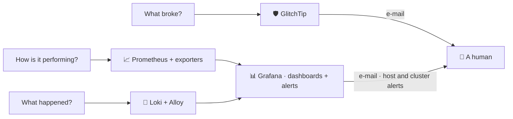

The [infrastructure topic](/architecture/infrastructure) shows where this runs; this one explains how it works. The design splits observability into three questions with three owners. In production they run as a shared platform stack inside the k3s cluster, declared in the be-infra repository and applied by Flux; locally the same three answers come from a Compose overlay in the dev environment. The questions, the dashboards and the GlitchTip setup carry over between the two. The plumbing underneath does not, and the sections below say where they differ.

## Where it runs

**In production**, the `monitoring` namespace holds kube-prometheus-stack (Prometheus, Grafana, node-exporter for the host, kube-state-metrics for the cluster's own state, and the kubelet's built-in cAdvisor for every pod and container), plus Loki and Alloy. GlitchTip has a namespace of its own, `glitchtip`, with its Valkey alongside it and its database in the shared PostgreSQL cluster. Like every namespace on the cluster, both sit behind a resource quota and a default-deny network policy, and an app that wants to be scraped says so itself: a ServiceMonitor or PodMonitor in its own namespace, plus a NetworkPolicy that lets `monitoring` in. Alertmanager is not installed; host and cluster alerts are Grafana's (below).

**Locally**, one Compose file adds ten services: Prometheus, Grafana, Loki, Alloy, GlitchTip with its own Postgres and Valkey, and three exporters (cAdvisor for containers, node-exporter for the host, postgres-exporter for the app database). Everything binds to loopback by default, every service carries the same bounded log rotation, and two env vars refuse to default: Grafana's admin credentials and GlitchTip's secret key, because an earlier template shipped a Grafana that came up as admin/admin.

In the overlay, GlitchTip's datastores live on their own isolated network; only the collector itself is dual-homed, which is precisely what lets it probe the backend's management port for uptime checks while its database stays unreachable from the app network.

## Prometheus

In production there is no hand-written scrape config. Every target is a ServiceMonitor or PodMonitor declared next to the thing it watches: the backend's actuator on its management port 9091 (`/actuator/prometheus`, every 30 seconds), the PostgreSQL pod, GlitchTip, Traefik, the Flux controllers, Loki and Alloy, on top of the node, pod and cluster-state metrics the stack collects by default. The backend's job keeps the name `beyou-backend`, which is what the dashboards already query, so their queries carried over into the cluster. Metrics are kept for 15 days.

The local overlay does it the older way: a scrape config template rendered at container start (Prometheus does not expand environment variables, and the mount is read-only, so a tiny entrypoint script substitutes the port and token values before handing over to the real binary), with jobs for the backend, GlitchTip, Loki, Alloy, Grafana, the three exporters and Prometheus itself.

Prometheus still has no Alertmanager and no hostname: it stays an observation layer, reachable only through Grafana. What changed with the move is that alerts now come from two places with two jobs. GlitchTip keeps everything about the application: errors, uptime and heartbeats. Grafana owns the machine and the cluster, with seven alert rules evaluated against Prometheus (host memory almost full, heavy swapping, root disk almost full, a container restarting, a pod stuck, a deployment missing replicas, a scrape target down), sent by e-mail through a single contact point. On one laptop the host is part of the application's failure model, and before the move nothing alerted on it.

The self-scrapes matter more than they look: a dead log pipeline fails silent (ingestion just stops), so `up` for Loki and Alloy, plus Alloy's dropped-entries counter, are the only honest signals that logs were actually lost.

## Grafana

Version-pinned with a story attached: Grafana's bundled Drilldown apps update themselves, and a previous minor version broke when a plugin update assumed a newer module runtime. A pinned Grafana with unpinned plugins is a slow-motion version conflict, so the pin gets reviewed, not removed. In production the pin is the kube-prometheus-stack chart version, so Grafana moves only when that version is bumped in Git.

Datasources are provisioned read-only, and Loki is reachable only through Grafana, which is what keeps an unauthenticated Loki API off the network. The product dashboard adds a PostgreSQL datasource that logs in with a read-only database role, so a dashboard query cannot change anything. Dashboards are files, not click history. In production they are JSON in be-infra, shipped as ConfigMaps that Grafana's sidecar loads into a folder per app; the two big ones started as Python generators in the dev environment, where the local overlay still loads them:

| Dashboard | Covers |
|-----------|--------|
| Service Health | JVM, GC, HTTP percentiles, Hikari pool, Caffeine caches, repositories, scheduled tasks |
| AI Agent | Model calls and tokens per provider, tool usage (including destructive and XP-awarding counts), fallback hops, chain exhaustion |
| Product | Active users from the backend's gauge, plus login recency, check-ins, XP and AI usage read from the database |
| Logs | Volume and error charts plus a filterable live browser |
| Node and Traefik (platform) | The host's CPU, memory, disk and network, and every request through the ingress |

The Compose-era Containers dashboard, built on cAdvisor and postgres-exporter, stays in the local overlay only; in the cluster the node and pod views replace it.

## Loki and Alloy

In production Alloy runs as a DaemonSet and tails the log files of every pod under `/var/log/pods`; no Docker socket is involved. Each stream is labeled with its namespace, pod, container and app, and nothing else: no image tags, because every distinct label combination is a separate stream. The pipeline does one thing, unwrap the container runtime's log format; Loki detects log levels server-side (JSON, logfmt, and plain-text keywords with one detector), and raw lines stay grep-able. Retention is 30 days, enforced by the compactor, matching the error tracker's retention to the day.

Backend lines carry the caller's user id as a `[userId=…]` field, and it stays a field. Promoting it to a stream label would mint one stream per account, which is exactly the cardinality that makes a Loki install expensive, so queries extract it at read time with `pattern` instead.

The local overlay discovers containers through the Docker socket instead, keeping only those whose Compose project matches the beyou prefix. Its known failure mode is written into the config itself: the project filter derives from the checkout directory name, so running the stack from a directory that does not start with "beyou" silently stops all log flow.

Browser logs are deliberately not collected. That is GlitchTip's job, and the documentation warns explicitly against closing the gap by exposing a Loki push endpoint to the internet.

## GlitchTip

One all-in-one process (web, worker, and migrations together) with Postgres and Valkey behind it. In production that is a single-replica Deployment with the Recreate strategy, because two all-in-one pods would both run the scheduled tasks, and its database is `glitchtip` in the shared PostgreSQL cluster. Four projects split the reporting surfaces: backend, web, mobile, and a DSN-less infra project that exists purely so a database container outage is not mailed under the backend's name.

Everything in it is created and reconciled by a bootstrap script that treats itself, not the UI, as the source of truth: the organization, the team, the four projects, the uptime monitors probing addresses from inside the network (the backend's health endpoint — a named group that includes only local checks, never the full endpoint, so no indicator added later can put a network call in front of the probe, the web frontend's port, both databases, Valkey, Loki, Alloy, Prometheus, Grafana, GlitchTip's own health for the status page, and the public docs and landing pages), the heartbeat monitors, and four alert rules. The script drives the local stack. Production's GlitchTip came into the cluster with its database, so its organization, projects, rules and monitors carried over, and its uptime monitors were pointed at the cluster's Services instead of Compose container names. Exactly one rule per project, because the uptime notification path joins through the project and a second rule would mail every event twice.

The heartbeats are the subtle ones. The snapshot scheduler checks in only after a completed cycle, and GlitchTip alerts when 90 minutes pass without a check-in. The check is inverted on purpose: a wedged scheduler keeps the health endpoint green while silently writing no snapshots, so the alert fires on the absence of success rather than the presence of failure.

The engagement-nudge pass has the same heartbeat, and needs it more. A snapshot job that stops eventually shows up as missing history; a nudge job that stops looks exactly like a quiet week, because nobody complains about mail they did not receive. Its monitor is opt-in in the bootstrap script and deliberately so: the pass returns before checking in while `engagement.enabled` is false, so a monitor created ahead of that flag would page every 90 minutes about a job that is off on purpose. `GLITCHTIP_NUDGE_HEARTBEAT=1` belongs in the same change that turns the sender on.

The calendar reminder pass has one as well, `monitoring.heartbeat.reminder-url` (`REMINDER_HEARTBEAT_URL`), and unlike the nudges it is on by default, so it checks in every five minutes from the first deploy. A reminder job that stops looks like a quiet day, and the first anyone hears of it is a missed appointment. The bootstrap script does not create its monitor yet: until it does, the monitor is made by hand with an interval of about 900 seconds and its URL pasted into the backend's environment. Blank, the heartbeat makes no request at all.

Two more watch the backups, which exist only in production, and they are inverted for the same reason taken further: the nightly backup CronJob and the weekly restore drill both check in only on success, so a backup that stops running raises no error, fails no request, and turns nothing red. There are two rather than one because "uploaded without error" and "actually restores" are separate claims, and a backup that satisfies only the first is the ordinary way this fails.

Three sharp edges the script and docs carry: the first account to register becomes admin regardless of settings, so registration happens immediately after first boot; DSN public keys are stripped of hyphens because the JavaScript SDK's parser rejects hyphenated keys and then drops every event in total silence; and the script ends by checking the mail transport, shouting when e-mail is still the console backend, because a collector with every rule wired and no working mail looks healthy in exactly the wrong way.

GlitchTip is the one monitoring surface exposed publicly (through the tunnel and Traefik, at mnt.beyouweb.com), because real browsers and real phones must be able to deliver errors to it; the backend reaches it inside the cluster. Grafana is public too, at obs.beyouweb.com behind its own login; Prometheus, Loki, and Alloy have no hostname at all.

## The instrumented sides

**Backend**: the Sentry SDK is wired through logging, and the interesting choices are what it refuses to send. Default PII off, request bodies never (they carry user-written text), events only at ERROR (one handler logs upstream response bodies at WARN, and lowering the threshold would make those bodies into event messages). Deduplication collapses the triple capture of one fault, with one residual duplicate kept knowingly: the servlet container re-logs failures with a different throwable, and that line is the only signal for exceptions thrown in the filter chain. A before-send filter drops anything caused by a business exception, and fifteen loggers are excluded from breadcrumbs, including one that can leak a secret monitor URL through exception text. Custom metrics cover the LLM chain (calls, fallbacks, exhaustion), every agent tool execution, and Spring AI's token and latency instrumentation, threaded explicitly into the hand-built provider clients that would otherwise be invisible.

**Web**: telemetry is dormant without a DSN and aggressive about privacy with one. URLs are stripped of query strings in three places (the request, the referrer, and navigation breadcrumbs), because two screens carry live single-use tokens in theirs and a hard navigation makes the token-bearing URL the next page's referrer. UI breadcrumbs are rewritten down to bare DOM structure through an allowlist, because the check-in control is labeled with the user's own habit name and would otherwise attach it to every event. Render crashes and handled API failures each have a dedicated capture path, since error boundaries and a never-throwing API client both defeat automatic capture.

**Mobile**: wired the same dormant-without-DSN way, tracing pinned off, and delivery is proven: errors from a real device reach the collector under the mobile project.
