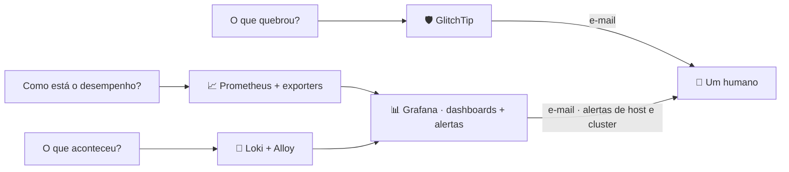

O [tópico de infraestrutura](/architecture/infrastructure) mostra onde isto roda; este explica como funciona. O design divide a observabilidade em três perguntas com três donos. Em produção elas rodam como uma stack de plataforma compartilhada dentro do cluster k3s, declarada no repositório be-infra e aplicada pelo Flux; localmente as mesmas três respostas vêm de um overlay do Compose no ambiente de desenvolvimento. As perguntas, os dashboards e a configuração do GlitchTip passam de um para o outro. O encanamento por baixo não, e as seções abaixo dizem onde eles diferem.

## Onde roda

**Em produção**, o namespace `monitoring` abriga o kube-prometheus-stack (Prometheus, Grafana, node-exporter para o host, kube-state-metrics para o estado do próprio cluster, e o cAdvisor embutido no kubelet para cada pod e container), mais Loki e Alloy. O GlitchTip tem um namespace só dele, `glitchtip`, com o seu Valkey ao lado e o banco no cluster PostgreSQL compartilhado. Como todo namespace do cluster, os dois ficam atrás de uma resource quota e de uma network policy default-deny, e um app que quer ser coletado diz isso ele mesmo: um ServiceMonitor ou PodMonitor no seu próprio namespace, mais uma NetworkPolicy que deixa o `monitoring` entrar. O Alertmanager não está instalado; os alertas de host e cluster são do Grafana (abaixo).

**Localmente**, um arquivo do Compose adiciona dez serviços: Prometheus, Grafana, Loki, Alloy, o GlitchTip com Postgres e Valkey próprios, e três exporters (cAdvisor para containers, node-exporter para o host, postgres-exporter para o banco do app). Tudo escuta em loopback por padrão, todo serviço carrega a mesma rotação limitada de logs, e duas variáveis de ambiente se recusam a ter default: as credenciais de admin do Grafana e a chave secreta do GlitchTip, porque um template anterior entregava um Grafana que subia como admin/admin.

No overlay, os bancos do GlitchTip vivem em uma rede própria isolada; só o coletor é dual-homed, exatamente o que o deixa sondar a porta de management do backend para checagens de uptime enquanto seu banco fica inalcançável pela rede do app.

## Prometheus

Em produção não há configuração de coleta escrita à mão. Cada alvo é um ServiceMonitor ou PodMonitor declarado ao lado do que ele observa: o actuator do backend na porta de management 9091 (`/actuator/prometheus`, a cada 30 segundos), o pod do PostgreSQL, o GlitchTip, o Traefik, os controllers do Flux, Loki e Alloy, além das métricas de nó, de pods e de estado do cluster que a stack coleta por padrão. O job do backend mantém o nome `beyou-backend`, que é o que os dashboards já consultam, então as consultas deles vieram junto para o cluster. As métricas ficam guardadas por 15 dias.

O overlay local faz do jeito antigo: um template de configuração de coleta renderizado na partida do container (o Prometheus não expande variáveis de ambiente, e o mount é somente-leitura, então um entrypoint minúsculo substitui portas e token antes de entregar ao binário real), com jobs para o backend, GlitchTip, Loki, Alloy, Grafana, os três exporters e o próprio Prometheus.

O Prometheus continua sem Alertmanager e sem hostname: segue como camada de observação, alcançável só pelo Grafana. O que mudou com a migração é que os alertas agora vêm de dois lugares com dois papéis. O GlitchTip fica com tudo que é da aplicação: erros, uptime e heartbeats. O Grafana cuida da máquina e do cluster, com sete regras de alerta avaliadas sobre o Prometheus (memória do host quase cheia, swap pesado, disco raiz quase cheio, um container reiniciando, um pod travado, um deployment sem réplicas, um alvo de coleta fora do ar), enviadas por e-mail por um único ponto de contato. Num laptop só, o host faz parte do modelo de falha da aplicação, e antes da migração nada alertava sobre ele.

Os self-scrapes importam mais do que parecem: um pipeline de logs morto falha em silêncio (a ingestão simplesmente para), então o `up` do Loki e do Alloy, mais o contador de entradas descartadas do Alloy, são os únicos sinais honestos de que logs foram de fato perdidos.

## Grafana

Com versão fixada e uma história junto: os apps de Drilldown embutidos no Grafana se atualizam sozinhos, e uma versão anterior quebrou quando uma atualização de plugin assumiu um runtime de módulos mais novo. Um Grafana fixado com plugins soltos é um conflito de versões em câmera lenta, então o pin é revisado, nunca removido. Em produção o pin é a versão do chart do kube-prometheus-stack, então o Grafana só muda quando essa versão sobe no Git.

Os datasources são provisionados somente-leitura, e o Loki só é alcançável pelo Grafana, que é o que mantém uma API sem autenticação fora da rede. O dashboard de produto acrescenta um datasource PostgreSQL que entra com um role de banco somente leitura, então uma consulta de dashboard não consegue mudar nada. Dashboards são arquivos, não histórico de cliques. Em produção são JSON no be-infra, entregues como ConfigMaps que o sidecar do Grafana carrega numa pasta por app; os dois grandes nasceram como geradores Python no ambiente de desenvolvimento, onde o overlay local ainda os carrega:

| Dashboard | Cobre |
|-----------|-------|
| Service Health | JVM, GC, percentis de HTTP, pool Hikari, caches Caffeine, repositórios, tarefas agendadas |
| AI Agent | Chamadas de modelo e tokens por provedor, uso de ferramentas (incluindo contagens de destrutivas e das que dão XP), saltos de fallback, cadeia esgotada |
| Product | Usuários ativos a partir do gauge do backend, mais recência de login, check-ins, XP e uso de IA lidos do banco |
| Logs | Gráficos de volume e erro mais um navegador ao vivo filtrável |
| Node e Traefik (plataforma) | CPU, memória, disco e rede do host, e cada requisição que passa pelo ingress |

O dashboard Containers da época do Compose, montado sobre cAdvisor e postgres-exporter, fica só no overlay local; no cluster as visões de nó e de pods o substituem.

## Loki e Alloy

Em produção o Alloy roda como DaemonSet e acompanha os arquivos de log de cada pod em `/var/log/pods`; nenhum socket do Docker envolvido. Cada stream é etiquetado com namespace, pod, container e app, e nada mais: sem tags de imagem, porque cada combinação distinta de labels é um stream separado. O pipeline faz uma coisa só, desembrulhar o formato de log do runtime de containers; o Loki detecta níveis de log no servidor (JSON, logfmt e palavras-chave de texto puro com um único detector), e as linhas cruas continuam grep-áveis. A retenção é de 30 dias, imposta pelo compactor, casando com a retenção do rastreador de erros no dia.

As linhas do backend carregam o id de quem chamou como um campo `[userId=…]`, e ele continua sendo campo. Promovê-lo a label de stream criaria um stream por conta, que é justamente a cardinalidade que encarece uma instalação do Loki, então as consultas o extraem na leitura, com `pattern`.

O overlay local descobre containers pelo socket do Docker, mantendo só os que têm projeto Compose casando com o prefixo beyou. O modo de falha conhecido dele está escrito na própria configuração: o filtro de projeto deriva do nome do diretório do checkout, então subir a stack de um diretório que não começa com "beyou" para todo o fluxo de logs em silêncio.

Logs de navegador deliberadamente não são coletados. Esse é o trabalho do GlitchTip, e a documentação avisa explicitamente contra fechar a lacuna expondo um endpoint de push do Loki à internet.

## GlitchTip

Um processo tudo-em-um (web, worker e migrações juntos) com Postgres e Valkey atrás. Em produção isso é um Deployment de uma réplica com a estratégia Recreate, porque dois pods tudo-em-um rodariam os dois as tarefas agendadas, e o banco é o `glitchtip` no cluster PostgreSQL compartilhado. Quatro projetos separam as superfícies de reporte: backend, web, mobile e um projeto de infra sem DSN, que existe puramente para uma queda de container de banco não ser enviada por e-mail em nome do backend.

Tudo nele é criado e reconciliado por um script de bootstrap que trata a si mesmo, não a UI, como fonte de verdade: a organização, o time, os quatro projetos, os monitores de uptime sondando endereços de dentro da rede (a saúde do backend — um grupo nomeado que inclui só checagens locais, nunca o endpoint inteiro, para nenhum indicador adicionado depois colocar uma chamada de rede na frente da sonda, a porta do frontend web, os dois bancos, o Valkey, Loki, Alloy, Prometheus, Grafana, a própria saúde do GlitchTip para a página de status, e as páginas públicas da documentação e da landing), os monitores de heartbeat e quatro regras de alerta. O script cuida da stack local. O GlitchTip de produção entrou no cluster junto com o seu banco, então a organização, os projetos, as regras e os monitores vieram junto, e os monitores de uptime passaram a apontar para os Services do cluster em vez dos nomes de container do Compose. O monitor do web app é a exceção: o app foi para a Cloudflare, então o monitor faz uma requisição a https://app.beyouweb.com pela internet. Exatamente uma regra por projeto, porque o caminho de notificação de uptime passa pelo projeto e uma segunda regra enviaria cada evento duas vezes.

Os heartbeats são os sutis. O scheduler de snapshots só se reporta depois de um ciclo completo, e o GlitchTip alerta quando 90 minutos passam sem reporte. A checagem é invertida de propósito: um scheduler travado mantém o endpoint de saúde verde enquanto silenciosamente não escreve snapshot nenhum, então o alerta dispara na ausência de sucesso, não na presença de falha.

A passada de nudges de engajamento tem o mesmo heartbeat, e precisa mais dele. Um job de snapshot que para acaba aparecendo como histórico faltando; um job de nudge que para parece exatamente uma semana quieta, porque ninguém reclama de e-mail que não recebeu. O monitor dele é opt-in no script de bootstrap, e de propósito: a passada retorna antes de se reportar enquanto `engagement.enabled` for false, então um monitor criado antes dessa flag alertaria a cada 90 minutos sobre um job que está desligado de propósito. `GLITCHTIP_NUDGE_HEARTBEAT=1` entra na mesma mudança que liga o remetente.

A passada de lembretes do calendário também tem o seu, `monitoring.heartbeat.reminder-url` (`REMINDER_HEARTBEAT_URL`), e ao contrário dos nudges ela vem ligada, então se reporta a cada cinco minutos desde o primeiro deploy. Um job de lembretes que para parece um dia tranquilo, e a primeira notícia disso é um compromisso perdido. O script de bootstrap ainda não cria esse monitor: até criar, ele é feito à mão com um intervalo de uns 900 segundos e a URL vai para o ambiente do backend. Em branco, o heartbeat não faz requisição nenhuma.

Mais dois cuidam dos backups, que só existem em produção, invertidos pelo mesmo motivo levado adiante: o CronJob noturno de backup e o teste semanal de restauração só se reportam quando dão certo, então um backup que para de rodar não gera erro, não falha requisição nenhuma e não deixa nada vermelho. São dois e não um porque "subiu sem erro" e "restaura de verdade" são afirmações diferentes, e um backup que só cumpre a primeira é o jeito comum de isso dar errado.

Três bordas afiadas que o script e a documentação carregam: a primeira conta a se registrar vira admin independentemente das configurações, então o registro acontece imediatamente após o primeiro boot; as chaves públicas de DSN perdem os hífens porque o parser do SDK JavaScript rejeita chaves com hífen e então descarta todo evento em silêncio total; e o script termina conferindo o transporte de e-mail, gritando quando o e-mail ainda é o backend de console, porque um coletor com todas as regras ligadas e sem correio funcionando parece saudável exatamente do jeito errado.

O GlitchTip é a única superfície de monitoramento exposta publicamente (pelo túnel e pelo Traefik, em mnt.beyouweb.com), porque navegadores e celulares reais precisam conseguir entregar erros a ele; o backend o alcança por dentro do cluster. O Grafana também é público, em obs.beyouweb.com atrás do próprio login; Prometheus, Loki e Alloy não têm hostname algum.

## Os lados instrumentados

**Backend**: o SDK do Sentry entra pelo logging, e as escolhas interessantes são o que ele se recusa a enviar. PII padrão desligado, corpos de requisição nunca (carregam texto escrito pelo usuário), eventos só em ERROR (um handler registra corpos de resposta de upstream em WARN, e baixar o limiar transformaria esses corpos em mensagens de evento). A deduplicação colapsa a captura tripla de uma falha, com uma duplicata residual mantida de propósito: o container servlet re-loga falhas com um throwable diferente, e essa linha é o único sinal para exceções lançadas na cadeia de filtros. Um filtro de before-send descarta qualquer coisa causada por exceção de negócio, e quinze loggers ficam fora dos breadcrumbs, incluindo um que pode vazar uma URL secreta de monitor pelo texto de exceção. Métricas próprias cobrem a cadeia de LLM (chamadas, fallbacks, esgotamento), cada execução de ferramenta do agente e a instrumentação de tokens e latência do Spring AI, passada explicitamente para os clientes de provedor montados à mão que de outro modo seriam invisíveis.

**Web**: a telemetria fica dormente sem DSN e agressiva com privacidade com um. URLs perdem a query string em três lugares (a requisição, o referrer e os breadcrumbs de navegação), porque duas telas carregam tokens vivos de uso único nas suas e uma navegação dura faz da URL com token o referrer da página seguinte. Breadcrumbs de UI são reescritos até a estrutura nua do DOM por uma allowlist, porque o controle de check-in é rotulado com o nome do próprio hábito do usuário e o anexaria a cada evento. Quebras de renderização e falhas de API tratadas têm caminhos de captura dedicados, já que error boundaries e um cliente de API que nunca lança derrotam a captura automática.

**Mobile**: ligado do mesmo jeito dormente-sem-DSN, tracing fixado em desligado, e a entrega está provada: erros de um aparelho real chegam ao coletor no projeto do mobile.
