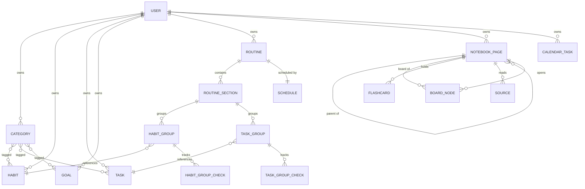
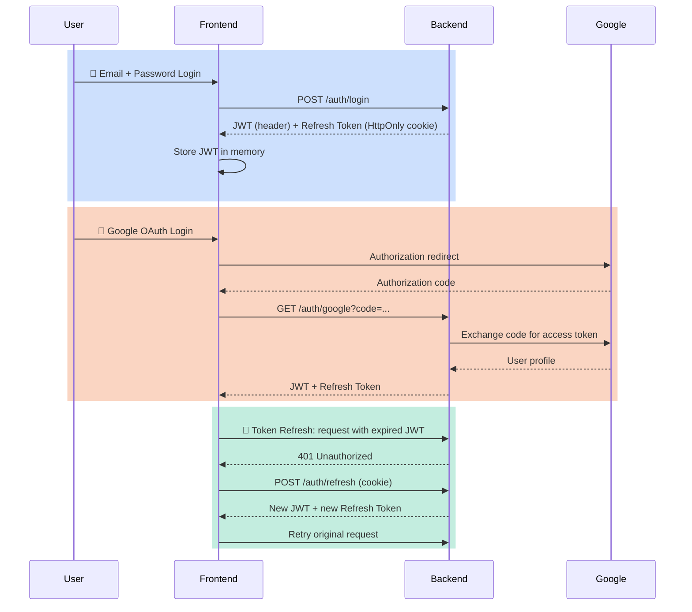
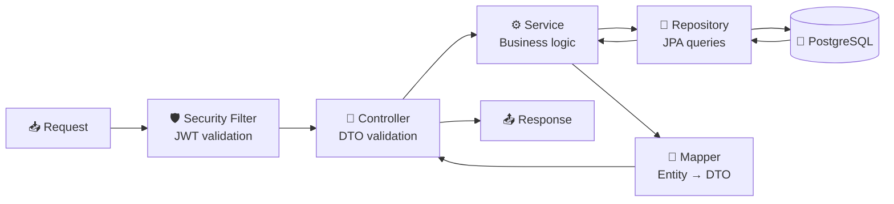
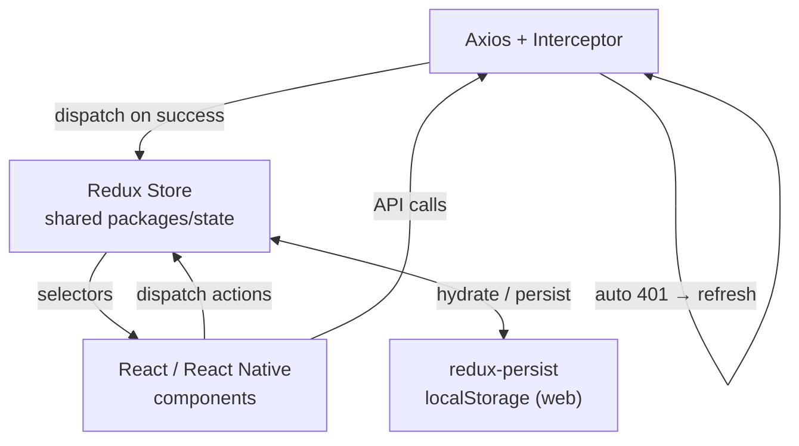
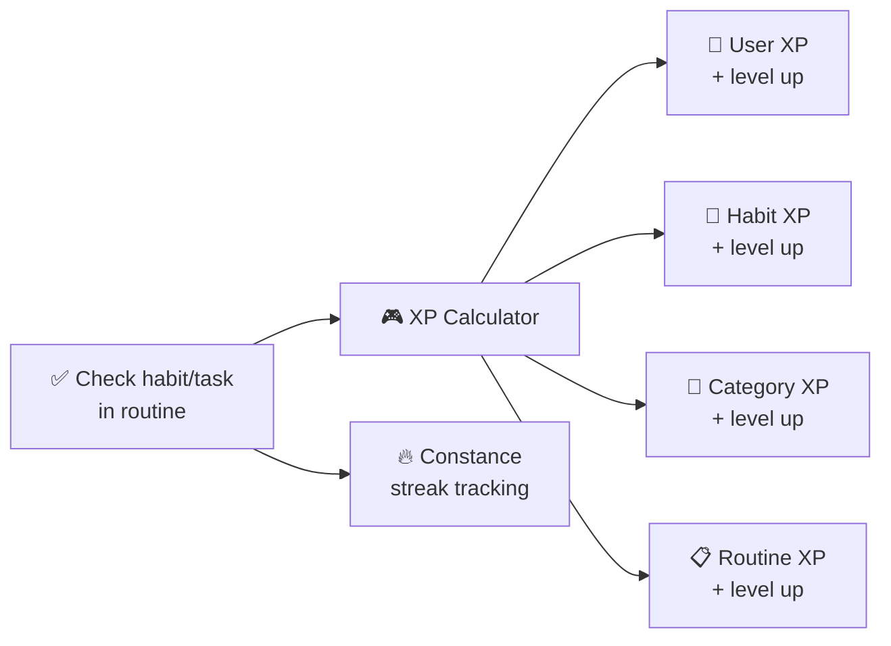

This is the map of the system as it runs in production: every client surface, the API behind them, the database, how new code reaches production, and how we find out when something breaks. The diagram above shows the whole picture; the sections below walk through each piece.

## Tech stack

| Layer | Technologies |
|-------|-------------|
| **Web app** | React 18, TypeScript, Vite, Redux Toolkit, Axios, react-hook-form + Zod, i18next (en/pt), Tailwind CSS 3. The study notebook adds BlockNote on Mantine 8 for the editor and React Flow for the roadmap board |
| **Mobile app** | React Native + Expo (Android first), NativeWind, TypeScript. Shares the state, API client, and i18n packages with the web app through the monorepo |
| **Backend** | Spring Boot 4.1, Java 25 (virtual threads), Spring Security, JWT (auth0 java-jwt), Spring AOP, Spring AI for the agent chat, onboarding suggestions and the study notebook's AI (LLM fallback chain), PDFBox and jsoup for notebook sources |
| **Database** | PostgreSQL 17 in production (a CloudNativePG cluster; tests and the local stacks run 15), Flyway-owned schema (Hibernate validates it, never writes it), UUID primary keys, Caffeine cache in front of hot reads |
| **Delivery** | GitHub Actions builds the backend image to GHCR; Flux (GitOps) rolls it out on a single-node k3s cluster; CI deploys the web and docs builds to Cloudflare Workers Static Assets with wrangler; Docker Compose for local development and e2e |
| **Monitoring** | kube-prometheus-stack (Prometheus, Grafana), Loki + Alloy, GlitchTip (Sentry-compatible) |

## Production topology

Production runs on a single-node k3s cluster whose whole state lives in Git and is applied by Flux, with Cloudflare serving the two static sites. The application side is three pieces, all built by CI:

- **beyou-backend**: the Spring Boot API on port 8099, everything under `/api/v1`, running in the `beyou` namespace from an image on GitHub Container Registry. Public at **api.beyouweb.com**, which the web app and the docs pages call straight from the browser. One replica, with uploads on a persistent volume.
- **beyou-web**: the web app's static build, served from Cloudflare Workers Static Assets by a Worker that runs no script. Public at **app.beyouweb.com**.
- **beyou-docs**: this documentation site, prerendered to static HTML and served by Cloudflare the same way. Public at **docs.beyouweb.com**.

The database is `beyou` in a shared PostgreSQL 17 cluster run by the CloudNativePG operator in the `data` namespace. Merging to main is the deployment. For the backend, CI pushes a new `:latest` image, Flux's image automation records its digest in Git and rolls it out, and rolling back is a `git revert`. The two static sites go from their own CI to Cloudflare with `wrangler deploy`, and they roll back there too. Nothing on the server listens on a public port. A Cloudflare Tunnel dials out from the server and hands the cluster's public hostnames to Traefik, the only ingress, which routes by host to each Ingress; every namespace sits behind a default-deny network policy. The [infrastructure topic](/architecture/infrastructure) covers the machine, the cluster and the backups. Two more pieces live outside the cluster: the marketing site at **beyouweb.com** (static HTML on Cloudflare Pages) and the mobile app, which installs on the phone and talks to the same API as the web app.

The content of this docs site has its own pipeline: markdown and OpenAPI specs live in the beyou-arch-design repository, the backend imports them into PostgreSQL, and a content change rebuilds the prerendered docs site and deploys it to Cloudflare.

## Monitoring

In production the observability stack runs inside the cluster as kube-prometheus-stack plus Loki, Alloy and GlitchTip; locally a Compose overlay answers the same questions. Each component answers a different question:

- **Prometheus** answers "how is it performing?". It scrapes the backend's actuator on its management port plus the host (node-exporter), every pod and container (the kubelet's cAdvisor), the cluster's own state and the database, so JVM internals, per-pod resources, the host, and the database are all on the same board.
- **Loki + Alloy** answer "what happened?". Alloy runs on the node, tails the logs of every pod, and pushes them to Loki. The apps need no log configuration at all, and logs are kept for 30 days.
- **GlitchTip** answers "what broke?". The backend, the web app, and the mobile app all deliver errors to it through Sentry SDKs. It is public at **mnt.beyouweb.com** because real browsers and real phones must be able to reach it. It also runs the uptime and heartbeat monitors, since it is the piece that can notify a human.

Grafana sits on top of all three, with dashboards loaded from Git: backend service health, the AI agent, product usage, logs, the host and the ingress. It also e-mails the alerts about the machine and the cluster (memory, disk, restarting or stuck pods, targets down), while GlitchTip keeps the application's. It lives at **obs.beyouweb.com**, behind its own login. Those two are the only public monitoring surfaces; Prometheus, Loki and the exporters have no hostname and are only reachable through Grafana.

## Domain model

### Entity highlights

- **User**: profile, preferences (theme, language, widgets), and embedded XP progression (level, xp, constance streak).
- **Category**: groups habits, tasks, and goals via ManyToMany. Has its own XP/level.
- **Habit**: trackable behavior with importance, difficulty, motivational phrase, and XP/level progression.
- **Task**: like a habit, but can be one-time (oneTimeTask) with soft-delete via markedToDelete.
- **Goal**: target-based with currentValue / targetValue, a status (NOT_STARTED / IN_PROGRESS / COMPLETED) derived from progress and completion, a term (SHORT / MEDIUM / LONG), and an optional parent goal for nesting up to three levels.
- **Routine**: abstract base with DiaryRoutine as the concrete type, and a routineType column choosing the shape. A DAILY routine holds sections with habit/task groups on a clock; a LIST one is a flat, ordered checklist with no sections and no times.
- **Schedule**: days of the week linked to a routine.
- **Checks**: daily check/skip records for habit and task groups inside routines, with XP generation tracking.
- **Routine snapshots**: an immutable daily copy of each routine, taken per timezone by a scheduler, so history survives later edits to the routine.
- **Check and XP history**: per-day records behind the dashboard's history and progress widgets.
- **Calendar task**: a one-off task on a date, with an optional time and a reminder. It lives outside routines, pays a flat 10 XP when completed, and stays on its own day whether done or not.
- **Feedback**: in-app feedback reports, delivered with optional screenshots and browsable by an admin.
- **Study notebook**: everything is a page, a topic being the root one. A page can hold one roadmap board whose nodes open other pages, flashcards on a spaced schedule, and sources (PDF, link, text) a grounded study AI answers from with citations. Study cycles put topics in a queue of time and goal blocks studied lap after lap, fed by pomodoros on the topic's pages and by sessions logged by hand.

## Authentication flow

### Token details

- **Access token (JWT)**: 15 minutes, HMAC256. Requests carry it as `Authorization: Bearer`; the backend delivers a fresh one in the `X-Access-Token` response header.
- **Refresh token**: 15 days, opaque hashed token in an HttpOnly cookie. The old token is revoked on every refresh.
- **Email verification**: new accounts confirm their address by email before the first login, and can ask for another link if the first never arrives.
- **Password reset**: secure token by email, 15 minute TTL, 5 minute cooldown between requests. All refresh tokens are revoked on reset.
- **Account deletion**: confirmed with a short-lived code (15 minute TTL) before anything is removed.
- **Federated sign-in (OIDC)**: any provider configured under `beyou.oidc.providers` gets a button on the web login. The client sends the ID token it verified through PKCE, and the account is found by the token's issuer and subject, never by its e-mail, so a new provider can only reach an existing account through a link made from inside it. Off when nothing is configured. The [security topic](/architecture/security) has the rules.

## API layer

36 REST controllers organized by domain, all under `/api/v1`:

| Group | Controllers | Base paths |
|-------|-----------|------------|
| **Auth** | Authentication, AuthVerification | /auth/* |
| **Core entities** | Category, Habit, Task, Goal | /category, /habit, /task, /goal |
| **Routines** | Routine, Schedule, Snapshot | /routine, /schedule, /routine/snapshot |
| **History** | CheckHistory, XpHistory | /check-history, /xp |
| **Focus Mode** | Focus | /focus/cycles, /focus/micro-tasks, /focus/day |
| **Diary** | Mood | /mood |
| **Calendar** | Calendar | /calendar, /calendar/tasks |
| **Study notebook** | Notebook, NotebookBoard, NotebookCard, NotebookSource, NotebookStudy, NotebookAi, StudyCycle | /notebook/* |
| **Daily Briefing** | DailyBriefing | /daily-briefing |
| **User** | User, UserPhoto, UserExport | /user, /user/photo |
| **AI** | AiAgent, Onboarding | /ai/agent, /onboarding |
| **Feedback** | Feedback, FeedbackAdmin | /feedback, /feedback/admin |
| **Notifications** | NotificationPreferences | /notification/preferences, /notification/unsubscribe |
| **Docs** | Architecture, Blog, Api, Project, Search, Import | /docs/* |

### Request/response pattern

- Request DTOs are validated with Jakarta Bean Validation (@NotBlank, @Size, @Email).
- Responses go through dedicated Mapper classes (entity → response DTO).
- A global exception handler turns errors into a standardized ApiErrorResponse with error keys the frontends translate through i18n.

## State management (frontend)

The Redux slices live in a shared workspace package (`packages/state`, 21 slices), so the web and mobile apps run the same state logic. The web app wraps it with redux-persist and deliberately excludes the profile, snapshot, celebration, mood, notebook and studyCycles slices, so no PII, journal text or study notes land in localStorage. The mobile app keeps its store in memory and refetches on launch.

## Gamification system

- **XpProgress** is an embeddable component shared by User, Category, Habit, and Routine.
- XP is generated when a habit or task is checked inside a routine.
- Completing a calendar task pays the user 10 XP, and un-completing takes that back.
- The study notebook pays fixed amounts once each: 15 for a page finished the first time, 20 for a quiz passed the first time, 1 per reviewed flashcard up to 30 a day.
- Level progression follows a seeded XP-per-level table (XpByLevelSeeder).
- Constance (streak) tracks consecutive completed days on the User entity.
- Goals award a fixed xpReward on completion.
