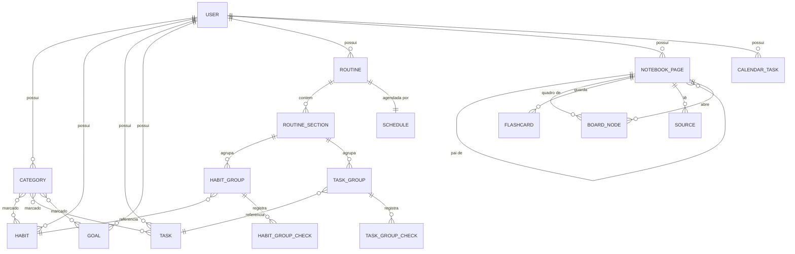
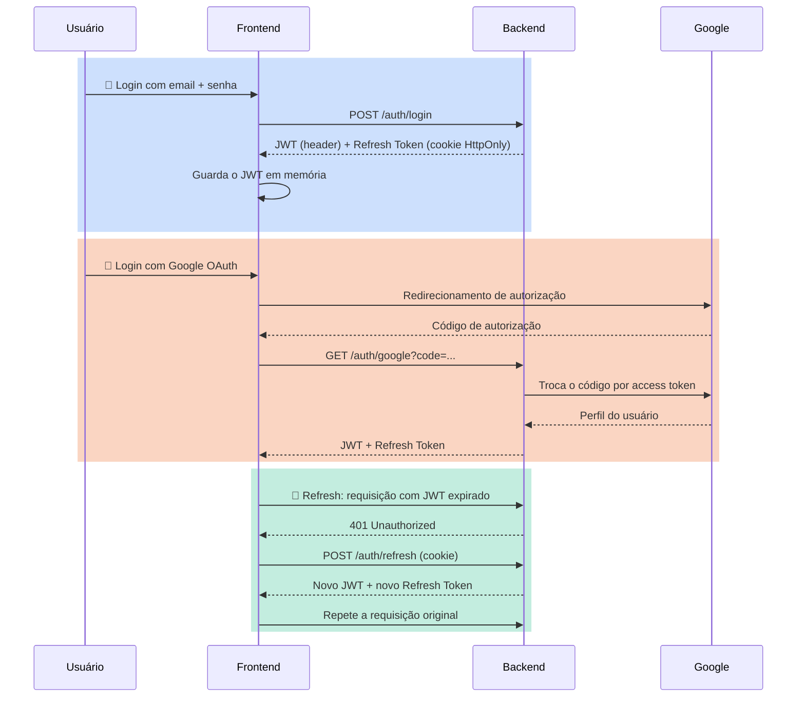
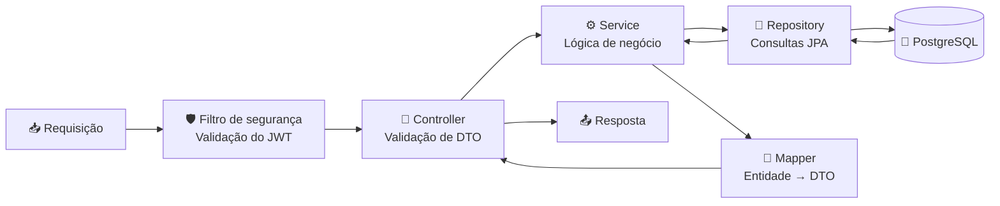
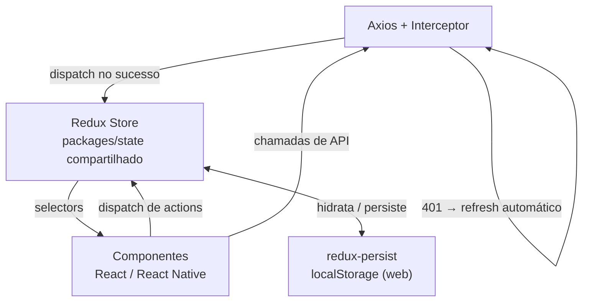
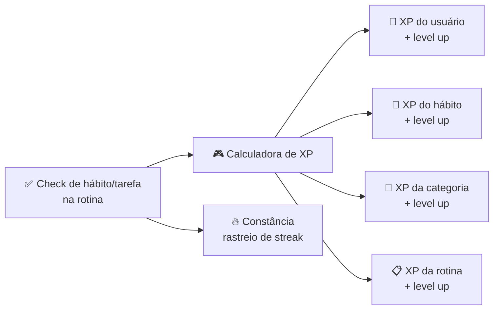

Este é o mapa do sistema como ele roda em produção: cada superfície de cliente, a API por trás delas, o banco de dados, como código novo chega ao servidor e como descobrimos quando algo quebra. O diagrama acima mostra o quadro completo; as seções abaixo percorrem cada peça.

## Stack tecnológica

| Camada | Tecnologias |
|--------|-------------|
| **Web app** | React 18, TypeScript, Vite, Redux Toolkit, Axios, react-hook-form + Zod, i18next (en/pt), Tailwind CSS 3. O caderno de estudos acrescenta o BlockNote sobre o Mantine 8 para o editor e o React Flow para o quadro de roadmap |
| **App mobile** | React Native + Expo (Android primeiro), NativeWind, TypeScript. Divide os pacotes de estado, cliente de API e i18n com o web app pelo monorepo |
| **Backend** | Spring Boot 4.1, Java 25 (virtual threads), Spring Security, JWT (auth0 java-jwt), Spring AOP, Spring AI para o chat do agente, as sugestões de onboarding e a IA do caderno de estudos (cadeia de fallback de LLMs), PDFBox e jsoup para as fontes do caderno |
| **Banco de dados** | PostgreSQL 17 em produção (um cluster CloudNativePG; os testes e as stacks locais rodam o 15), schema controlado pelo Flyway (o Hibernate valida, nunca escreve), chaves primárias UUID, cache Caffeine na frente das leituras quentes |
| **Entrega** | GitHub Actions constrói as imagens para o GHCR; o Flux (GitOps) faz o rollout delas num cluster k3s de um nó; nginx serve os builds do web e da documentação; Docker Compose para desenvolvimento local e e2e |
| **Monitoramento** | kube-prometheus-stack (Prometheus, Grafana), Loki + Alloy, GlitchTip (compatível com Sentry) |

## Topologia de produção

A produção é um cluster k3s de um nó cujo estado inteiro vive no Git e é aplicado pelo Flux. O lado da aplicação são três workloads no namespace `beyou`, todos construídos pelo CI e publicados no GitHub Container Registry:

- **beyou-backend**: a API Spring Boot na porta 8099, tudo sob `/api/v1`. Pública em **api.beyouweb.com**, e também atrás do proxy dos dois sites nginx. Uma réplica, com os uploads num volume persistente.
- **beyou-web**: o build estático do web app, servido pelo nginx. Público em **app.beyouweb.com**.
- **beyou-docs**: este site de documentação, pré-renderizado em HTML estático e servido pelo nginx. Público em **docs.beyouweb.com**.

O banco é o `beyou`, num cluster PostgreSQL 17 compartilhado, operado pelo CloudNativePG no namespace `data`. Fazer merge na main é o deploy: o CI publica uma imagem `:latest` nova, a automação de imagens do Flux registra o digest dela no Git e faz o rollout, e voltar atrás é um `git revert`. Nada escuta numa porta pública. Um Cloudflare Tunnel disca para fora a partir do servidor e entrega todos os hostnames públicos ao Traefik, o único ingress, que roteia por host para cada Ingress; todo namespace fica atrás de uma network policy default-deny. O [tópico de infraestrutura](/architecture/infrastructure) cobre a máquina, o cluster e os backups. Duas peças vivem fora do cluster: o site de marketing em **beyouweb.com** (HTML estático no Cloudflare Pages) e o app mobile, que é instalado no celular e fala com a mesma API do web app.

O conteúdo deste site de documentação tem seu próprio pipeline: o markdown e as specs OpenAPI vivem no repositório beyou-arch-design, o backend os importa para o PostgreSQL, e uma mudança de conteúdo dispara a reconstrução da imagem pré-renderizada.

## Monitoramento

Em produção a stack de observabilidade roda dentro do cluster como kube-prometheus-stack mais Loki, Alloy e GlitchTip; localmente um overlay do Compose responde as mesmas perguntas. Cada componente responde uma pergunta diferente:

- O **Prometheus** responde "como está o desempenho?". Ele coleta o actuator do backend na porta de management mais o host (node-exporter), cada pod e container (o cAdvisor do kubelet), o estado do próprio cluster e o banco, então internos da JVM, recursos por pod, o host e o banco ficam no mesmo painel.
- **Loki + Alloy** respondem "o que aconteceu?". O Alloy roda no nó, acompanha os logs de cada pod e os envia ao Loki. Os apps não precisam de nenhuma configuração de log, e os logs ficam guardados por 30 dias.
- O **GlitchTip** responde "o que quebrou?". O backend, o web app e o app mobile entregam erros a ele por SDKs do Sentry. Ele é público em **mnt.beyouweb.com** porque navegadores e celulares de verdade precisam alcançá-lo. Também roda os monitores de uptime e heartbeat, já que é a peça capaz de avisar um humano.

O Grafana fica em cima dos três, com dashboards carregados do Git: saúde do serviço do backend, o agente de IA, uso do produto, logs, o host e o ingress. Ele também manda por e-mail os alertas sobre a máquina e o cluster (memória, disco, pods reiniciando ou travados, alvos fora do ar), enquanto o GlitchTip fica com os da aplicação. Ele vive em **obs.beyouweb.com**, atrás do próprio login. Esses dois são as únicas superfícies públicas de monitoramento; Prometheus, Loki e os exporters não têm hostname e só são alcançáveis pelo Grafana.

## Modelo de domínio

### Destaques das entidades

- **User**: perfil, preferências (tema, idioma, widgets) e progressão de XP embutida (level, xp, constância).
- **Category**: agrupa hábitos, tarefas e metas via ManyToMany. Tem XP/level próprios.
- **Habit**: comportamento rastreável com importância, dificuldade, frase motivacional e progressão de XP/level.
- **Task**: como um hábito, mas pode ser única (oneTimeTask) com soft-delete via markedToDelete.
- **Goal**: baseada em alvo com currentValue / targetValue, um status (NOT_STARTED / IN_PROGRESS / COMPLETED) derivado do progresso e da conclusão, um prazo (SHORT / MEDIUM / LONG) e uma meta-pai opcional para aninhar até três níveis.
- **Routine**: base abstrata com DiaryRoutine como tipo concreto, e uma coluna routineType que escolhe a forma. Uma rotina DAILY tem seções com grupos de hábitos/tarefas no relógio; uma LIST é uma lista plana e ordenada, sem seções e sem horários.
- **Schedule**: dias da semana ligados a uma rotina.
- **Checks**: registros diários de check/skip para os grupos de hábitos e tarefas dentro das rotinas, com rastreio do XP gerado.
- **Snapshots de rotina**: uma cópia diária imutável de cada rotina, tirada por timezone por um scheduler, para que o histórico sobreviva a edições futuras da rotina.
- **Histórico de checks e XP**: registros por dia que sustentam os widgets de histórico e progresso do dashboard.
- **Tarefa do calendário**: uma tarefa avulsa numa data, com horário opcional e um lembrete. Fica fora das rotinas, paga 10 XP fixos quando concluída e continua no próprio dia, feita ou não.
- **Feedback**: relatos de feedback dentro do app, entregues com screenshots opcionais e navegáveis por um admin.
- **Caderno de estudos**: tudo é uma página, e o tópico é a página raiz. Uma página pode ter um quadro de roadmap cujos nós abrem outras páginas, flashcards num cronograma espaçado e fontes (PDF, link, texto) a partir das quais uma IA de estudo responde com citações. Os ciclos de estudo põem os tópicos numa fila de blocos de tempo e de objetivo, estudada volta após volta, alimentada pelos pomodoros nas páginas do tópico e pelas sessões lançadas à mão.

## Fluxo de autenticação

### Detalhes dos tokens

- **Access token (JWT)**: 15 minutos, HMAC256. As requisições o carregam em `Authorization: Bearer`; o backend entrega um novo no header de resposta `X-Access-Token`.
- **Refresh token**: 15 dias, token opaco com hash em cookie HttpOnly. O token antigo é revogado a cada refresh.
- **Verificação de e-mail**: contas novas confirmam o endereço por e-mail antes do primeiro login, e podem pedir outro link se o primeiro não chegar.
- **Redefinição de senha**: token seguro por e-mail, TTL de 15 minutos, 5 minutos de espera entre pedidos. Todos os refresh tokens são revogados na redefinição.
- **Exclusão de conta**: confirmada com um código de vida curta (TTL de 15 minutos) antes de qualquer remoção.
- **Login federado (OIDC)**: todo provedor configurado em `beyou.oidc.providers` ganha um botão no login web. O cliente envia o ID token que verificou pelo PKCE, e a conta é achada pelo emissor e pelo subject do token, nunca pelo e-mail, então um provedor novo só chega a uma conta existente por um vínculo feito de dentro dela. Desligado quando nada está configurado. O [tópico de segurança](/architecture/security) tem as regras.

## Camada de API

36 controllers REST organizados por domínio, todos sob `/api/v1`:

| Grupo | Controllers | Caminhos base |
|-------|-------------|---------------|
| **Auth** | Authentication, AuthVerification | /auth/* |
| **Entidades principais** | Category, Habit, Task, Goal | /category, /habit, /task, /goal |
| **Rotinas** | Routine, Schedule, Snapshot | /routine, /schedule, /routine/snapshot |
| **Histórico** | CheckHistory, XpHistory | /check-history, /xp |
| **Modo Foco** | Focus | /focus/cycles, /focus/micro-tasks, /focus/day |
| **Diário** | Mood | /mood |
| **Calendário** | Calendar | /calendar, /calendar/tasks |
| **Caderno de estudos** | Notebook, NotebookBoard, NotebookCard, NotebookSource, NotebookStudy, NotebookAi, StudyCycle | /notebook/* |
| **Resumo do Dia** | DailyBriefing | /daily-briefing |
| **Usuário** | User, UserPhoto, UserExport | /user, /user/photo |
| **IA** | AiAgent, Onboarding | /ai/agent, /onboarding |
| **Feedback** | Feedback, FeedbackAdmin | /feedback, /feedback/admin |
| **Notificações** | NotificationPreferences | /notification/preferences, /notification/unsubscribe |
| **Docs** | Architecture, Blog, Api, Project, Search, Import | /docs/* |

### Padrão de requisição/resposta

- Os DTOs de requisição são validados com Jakarta Bean Validation (@NotBlank, @Size, @Email).
- As respostas passam por classes Mapper dedicadas (entidade → DTO de resposta).
- Um handler global de exceções transforma erros em um ApiErrorResponse padronizado, com chaves de erro que os frontends traduzem via i18n.

## Gerenciamento de estado (frontend)

Os slices do Redux vivem em um pacote compartilhado do workspace (`packages/state`, 21 slices), então o web e o mobile rodam a mesma lógica de estado. O web app o envolve com redux-persist e exclui de propósito os slices de perfil, snapshot, celebration, mood, notebook e studyCycles, para que nenhum dado pessoal, texto de diário ou anotação de estudo caia no localStorage. O app mobile guarda a store em memória e rebusca ao abrir.

## Sistema de gamificação

- **XpProgress** é um componente embutível compartilhado por User, Category, Habit e Routine.
- O XP é gerado quando um hábito ou tarefa é marcado dentro de uma rotina.
- Concluir uma tarefa do calendário paga 10 XP ao usuário, e desmarcar devolve esse valor.
- O caderno de estudos paga valores fixos, uma vez cada: 15 por uma página concluída pela primeira vez, 20 por um quiz aprovado pela primeira vez, 1 por flashcard revisado até 30 por dia.
- A progressão de level segue uma tabela semeada de XP por level (XpByLevelSeeder).
- A constância (streak) rastreia dias consecutivos completados na entidade User.
- Metas concedem um xpReward fixo ao serem concluídas.
